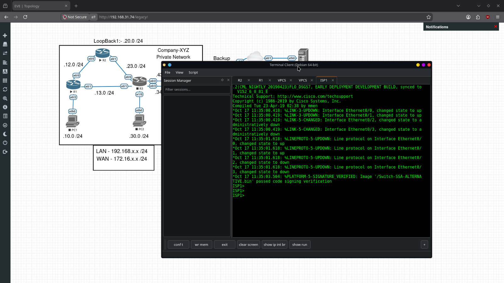

# EveTerminal 🚀
### Modern Multi-Tab & Tiled Terminal Client for Network Engineers
*The Ultimate Clean-Room Terminal for EVE-NG, GNS3, PNETLab, Cisco, Juniper, and Linux Infrastructure*

<p align="center">
  <a href="LICENSE"></a>
  <a href="https://debian.org"></a>
  <a href="https://python.org"></a>
  <a href="https://riverbankcomputing.com"></a>
  <a href="https://github.com"></a>
</p>

<p align="center">
  
</p>

---

## 📑 Table of Contents

- [Why EveTerminal?](#-why-eveterminal)
- [Feature Comparison Matrix](#-feature-comparison-matrix)
- [Key Capabilities](#-key-capabilities)
- [System Architecture](#-system-architecture)
- [Supported Platforms](#-supported-platforms)
- [Quick 1-Command Installation](#-quick-1-command-installation)
- [Installation via Standalone .deb Package](#-installation-via-standalone-deb-package)
- [EVE-NG & Browser One-Click Integration](#-eve-ng--browser-one-click-integration)
- [CLI Flags & Usage Guide](#-cli-flags--usage-guide)
- [Keyboard Shortcuts Reference](#-keyboard-shortcuts-reference)
- [Troubleshooting & FAQ](#-troubleshooting--faq)
- [Contributing](#-contributing)
- [Clean-Room Notice & Legal Disclaimers](#-clean-room-notice--legal-disclaimers)
- [License](#-license)

---

## 💡 Why EveTerminal?

Network engineers running **EVE-NG, GNS3, or PNETLab** on modern Linux systems (Debian, Ubuntu, Kali, Mint) have historically had to compromise:
- **Default terminals** (GNOME Terminal, Konsole, XFCE) spawn a separate floating window for every router clicked, cluttering your desktop with 20+ disconnected windows.
- **PuTTY** lacks a native multi-session tab bar and doesn't auto-tile into horizontal rows.
- **SecureCRT®** requires commercial activation licenses, and running older Windows releases under Wine suffers from socket disconnects, font scaling glitches, and desktop integration bugs.
- **The 30-Second Disconnect Problem**: Standard Linux telnet clients drop idle router sessions after 30 seconds due to virtual NAT timeouts.

**EveTerminal solves all of this out-of-the-box in a 100% free, open-source application.**

---

## 📊 Feature Comparison Matrix

| Feature | **EveTerminal** | **PuTTY / KiTTY** | **Default Terminals** | **SecureCRT® (Commercial)** |
| :--- | :---: | :---: | :---: | :---: |
| **Single-Window IPC** (all nodes open in 1 window) | ✅ **Yes** | ❌ No | ❌ Separate Windows | ✅ Yes |
| **Horizontal Tiled Rows** (`R1, R2, R3` layout) | ✅ **Yes** | ❌ No | ⚠️ Complex setup | ✅ Yes |
| **1-Click EVE-NG Browser Interception** (`telnet://`) | ✅ **Native** | ⚠️ Needs scripts | ⚠️ Opens separate apps | ⚠️ Complex config |
| **30-Second Keepalive Drop Fix** (`IAC NOP` keepalives) | ✅ **Built-in** | ⚠️ Manual config | ❌ Drops after 30s | ⚠️ Requires tweaking |
| **Cisco Command Autocomplete** (`Tab` key) | ✅ **Native** | ✅ Yes | ✅ Yes | ✅ Yes |
| **Cisco Break Sequence** (`Ctrl+Shift+6` / `Ctrl+^`) | ✅ **Native** | ⚠️ Mapping needed | ⚠️ Mapping needed | ✅ Yes |
| **Live Device Prompt Detection** (`R1#` $\rightarrow$ Tab sync) | ✅ **Automatic** | ❌ No | ❌ No | ❌ No |
| **SecureCRT `.ini` Sessions Import** | ✅ **Native** | ❌ No | ❌ No | ✅ Native |
| **Native Wayland & X11 Support** | ✅ **Qt6 Native** | ❌ X11 only | ✅ Yes | ❌ Wine/Legacy |
| **License Requirement** | 🆓 **100% Free / MIT** | 🆓 Free | 🆓 Free | 💲 Paid License |

---

## ⚡ Key Capabilities

### 1. 🪟 Single-Instance Window Management
- When you click router nodes in EVE-NG (`R1`, `R2`, `R3`), they attach seamlessly to the **same running window**.
- Built-in `QLocalServer` Unix domain socket IPC receives connection requests from browsers and CLI invocations, forwarding them to the existing window without spawning multiple instances.

### 2. 🛡️ Bulletproof Telnet Session Engine
- Implements full **RFC 854/855 Option Negotiation**:
  - `SGA` (Suppress Go Ahead) & `ECHO` for character-by-character interactive routers.
  - `NAWS` (Negotiate About Window Size - RFC 1073) dynamically synchronizing terminal dimensions.
  - `TTYPE` (Terminal Type - RFC 1091) advertising `VT100` compatibility.
- **Background Keepalive Heartbeat**: Sends Telnet `IAC NOP` (`\xff\xf1`) packets every 15 seconds during idle periods, keeping virtual NAT sessions, hypervisors, and reverse proxies alive indefinitely.
- **OS-Level Socket Tuning**: Automatically configures Linux kernel TCP keepalives (`SO_KEEPALIVE`, `TCP_KEEPIDLE=10s`, `TCP_KEEPINTVL=3s`, `TCP_KEEPCNT=5`).

### 3. ⌨️ Cisco IOS Command Autocompletion & Control Keys
- Custom Qt event handling bypasses widget focus navigation, routing the **`Tab`** key directly to the router CLI so typing `show ip interface bri` and pressing `Tab` expands to `brief`.
- Native Cisco break sequence: **`Ctrl+Shift+6`** or **`Ctrl+^`** (`\x1e`) halts runaway pings, traceroutes, or hung DNS queries instantly.
- Ergonomic Unix editing keys: `Ctrl+A` (home), `Ctrl+E` (end), `Ctrl+U` (erase line), `Ctrl+W` (erase word), `Ctrl+C` (abort).

### 4. 🏷️ Live Router Naming & Prompt Synchronization
- **Automatic Default Naming**: When you open nodes from EVE-NG, tabs are named **`R1`**, **`R2`**, **`R3`**, **`R4`** sequentially instead of displaying confusing IP/port numbers.
- **Real-Time Hostname Sync**: As soon as the router prompt arrives over the socket (`R1#`, `R2>`, `Core-SW1(config)#`), EveTerminal detects the hostname and updates the tab and row headers dynamically.
- **Right-Click Tab Rename**: Right-click any tab at any time to type a custom name or clone the session.

### 5. 🧱 Horizontal Rows Layout (`R1, R2, R3` Format)
- Switch between **Tabbed Mode** and **Tiled Horizontal Rows Mode** with one click via `View -> Window Layout -> Tile Horizontally (Rows: R1, R2, R3...)`.
- View all your lab routers simultaneously in vertically stacked rows with distinct title headers (`● R1`, `● R2`, `● R3`).

### 6. 📁 SecureCRT `.ini` Compatibility
- Reads and parses VanDyke line-oriented configuration schemas (`S:"Key"=String`, `D:"Key"=Hex32`, `B:"Key"=Binary`, `Z:"Key"=List`).
- Supports SecureCRT color schemes: *Traditional (Green on Black)*, *Monochrome (Amber on Black)*, *Yellow on Black*, *Black on White*, and custom ANSI palettes.
- Python scripting shim compatible with `crt.Screen`, `crt.Session`, `crt.Dialog`, and `crt.GetScriptTab()`.

---

## 🏛️ System Architecture

```
+-----------------------------------------------------------------------------+
|                            User Desktop Interface                           |
|       (Browser: Firefox / Chrome)             (CLI: eveterminal /T /N R1)   |
+------------------------------------+----------------------------------------+
                                     |
                                     v
+-----------------------------------------------------------------------------+
|                      Single-Instance IPC Dispatcher                         |
|      (/tmp/eveterminal_single_instance_ipc Unix Domain Local Socket)        |
+------------------------------------+----------------------------------------+
                                     |
                                     v
+-----------------------------------------------------------------------------+
|                           EveTerminal Main Window                           |
|  +--------------------+  +-----------------------------------------------+  |
|  | Session Tree Dock  |  | Multi-Tab & Tiled Rows Manager (R1, R2, R3)    |  |
|  | (Saved Sessions)   |  | +-------------------------------------------+ |  |
|  +--------------------+  | | Interactive Monospace Canvas              | |  |
|  | Macro Button Bar   |  | | - VT100 / VT220 / ANSI Screen Buffer      | |  |
|  | [sh ip int br] [+] |  | | - Copy on Select & Right-Click Paste       | |  |
|  +--------------------+  | +-------------------------------------------+ |  |
|                          +-----------------------------------------------+  |
+------------------------------------+----------------------------------------+
                                     |
                                     v
+-----------------------------------------------------------------------------+
|                       Asynchronous Protocol Backends                        |
|  [RFC 854/855 Telnet Engine]   [Paramiko SSHv2]   [PySerial]   [PTY Bash]   |
|  - Keepalives (IAC NOP 15s)    - Keepalives (15s) - /dev/ttyUSB- Local Shell|
|  - SGA, ECHO, NAWS, TTYPE      - RSA/Ed25519 Keys - Baud Config- Termios    |
+------------------------------------+----------------------------------------+
                                     |
                                     v
+-----------------------------------------------------------------------------+
|                       Lab & Production Endpoints                            |
|       (EVE-NG Routers)        (GNS3 Nodes)        (Cisco / Juniper Devices) |
+-----------------------------------------------------------------------------+
```

---

## 🐧 Supported Platforms

| Distribution | Version | Architecture | Display Server |
| :--- | :--- | :--- | :--- |
| **Debian** | 11 (Bullseye), 12 (Bookworm), 13 (Trixie) | `amd64`, `arm64` | Wayland & X11 / Xwayland |
| **Ubuntu** | 20.04, 22.04, 24.04 LTS | `amd64`, `arm64` | Wayland & X11 |
| **Linux Mint** | 20, 21, 22 | `amd64` | X11 & Wayland |
| **Kali Linux** | 2023.x, 2024.x | `amd64`, `arm64` | X11 & Wayland |
| **Pop!_OS** | 22.04, COSMIC | `amd64` | Wayland & X11 |
| **Fedora / RHEL** | 38, 39, 40+ | `amd64` | Wayland & X11 |
| **Arch Linux** | Rolling | `amd64` | Wayland & X11 |

---

## 🚀 Quick 1-Command Installation

Open your terminal and run:

```bash
git clone https://github.com/AtharvK-Cyber/EveTerminal.git
cd EveTerminal
sudo bash install.sh
```

### What `install.sh` handles automatically:
1. Installs all required dependencies (`python3-pyqt6`, `python3-paramiko`, `python3-serial`).
2. Deploys the application payload to `/opt/eveterminal`.
3. Creates global CLI launchers (`/usr/local/bin/eveterminal` and alias `/usr/local/bin/securecrt-linux`).
4. Installs the high-resolution vector icon (`eveterminal.svg`) and desktop menu launcher.
5. Places a direct shortcut on your desktop (`~/Desktop/eveterminal.desktop`) and marks it trusted.
6. **Registers EveTerminal as default handler for `telnet://` and `ssh://`** across your desktop environment and browser.

---

## 📦 Installation via Standalone `.deb` Package

You can also compile and install a standalone Debian package:

```bash
# Build the .deb installer
bash package_deb.sh

# Install with dpkg
sudo dpkg -i eveterminal_1.0.0_amd64.deb
sudo apt-get install -f   # Resolve dependencies if needed
```

---

## 🌐 EVE-NG & Browser One-Click Integration

Once installed, **no complex browser setup is needed**:

1. Open your EVE-NG lab in **Firefox**, **Chrome**, **Brave**, or **Edge**.
2. Click any router node (e.g., `R1`).
3. Your browser will show a prompt:
   - *"Open with EveTerminal?"*
   - Check **"Always allow <eve-ip> to open these links"**.
   - Click **Open Link**.
4. The router console opens immediately inside EveTerminal.
5. Click `R2`, `R3`, `R4` $\rightarrow$ they attach automatically as new tabs (`R2`, `R3`) in the **same window**!

---

## 💻 CLI Flags & Usage Guide

```bash
# Connect to a router in a new tab (named R1)
eveterminal /T /N "R1" telnet://192.168.1.100:32769

# Connect with explicit IP and port
eveterminal /TELNET 192.168.1.100 32770

# Connect via SSHv2
eveterminal /SSH2 admin@192.168.1.1 22

# Connect to serial console (/dev/ttyUSB0 at 9600 baud)
eveterminal /SERIAL /dev/ttyUSB0 9600

# Open in horizontal tiled rows layout (R1, R2, R3 format)
eveterminal --rows /N "R1" telnet://192.168.1.100 32769

# Run a Python automation script
eveterminal /SCRIPT /path/to/backup_configs.py
```

### Full CLI Options Reference

| Flag | Equivalent | Description |
| :--- | :--- | :--- |
| `/T` | `--tab` | Forces connection to open in a new tab inside running window |
| `/N "<name>"` | `--name`, `-t`, `/TITLE=` | Specifies tab and pane title (e.g. `R1`, `Core-SW1`) |
| `/ROWS` | `--rows` | Displays open terminals tiled horizontally as stacked rows |
| `/COLS` | `--columns` | Displays open terminals tiled vertically as side-by-side columns |
| `/TELNET <h> <p>`| `telnet://<h>:<p>` | Connects via RFC 854/855 Telnet |
| `/SSH2 <h> <p>` | `ssh://<u>@<h>:<p>` | Connects via SSHv2 |
| `/SERIAL <p> <b>`| `-serial <p> <b>` | Connects to hardware serial port (e.g. `/dev/ttyUSB0 9600`) |
| `/SCRIPT <path>` | `--script <path>` | Executes Python automation script via `crt` shim |

---

## ⌨️ Keyboard Shortcuts Reference

| Shortcut | Action | Description |
| :--- | :--- | :--- |
| **`Tab`** | Autocomplete | Native Cisco IOS command completion (`show ip int bri` $\rightarrow$ `brief`) |
| **`Ctrl+Shift+6`** or **`Ctrl+^`** | Cisco Break | Aborts running ping, traceroute, or DNS lookup |
| **`Ctrl+Tab`** | Next Tab | Cycles to the next open session tab |
| **`Alt+Q`** | Quick Connect | Opens Quick Connect dialog (Telnet/SSH/Serial) |
| **`Alt+C`** | Session Manager | Toggles the Saved Session Tree sidebar |
| **`Alt+B`** | Clone Session | Duplicates active session connection in a new tab |
| **`Ctrl+Q`** | Exit | Closes EveTerminal and disconnects active sessions |
| **`Right-Click (Tab)`** | Tab Menu | Rename tab, clone session, or close tab |
| **`Left-Click + Drag`** | Copy on Select | Automatically copies selected text to system clipboard |
| **`Right-Click (Canvas)`**| Paste | Pastes clipboard content directly into terminal |

---

## 🔧 Troubleshooting & FAQ

### Q1: Clicking an EVE-NG node opens default terminal instead of EveTerminal
**Cause**: The desktop MIME association for `x-scheme-handler/telnet` was overwritten.  
**Fix**:
```bash
xdg-mime default eveterminal.desktop x-scheme-handler/telnet
xdg-mime default eveterminal.desktop x-scheme-handler/ssh
```

### Q2: Double-clicking the Desktop icon asks "Execute or View?"
**Cause**: GNOME / KDE security policy requires desktop shortcuts to be marked as trusted.  
**Fix**:
```bash
gio set ~/Desktop/eveterminal.desktop metadata::trusted true
chmod +x ~/Desktop/eveterminal.desktop
```

### Q3: Serial console permission denied (`/dev/ttyUSB0`)
**Cause**: Your Linux user does not belong to the serial dialout group.  
**Fix**:
```bash
sudo usermod -aG dialout $USER
```
*(Log out and log back in for group membership to take effect).*

### Q4: Running under pure Wayland shows fractional scaling font blur
**Cause**: Qt Wayland fractional scaling mismatch.  
**Fix**:
```bash
QT_QPA_PLATFORM=xcb eveterminal
```

---

## 🤝 Contributing

We welcome contributions from network engineers, developers, and lab enthusiasts!
Please see [CONTRIBUTING.md](CONTRIBUTING.md) for development setup, unit testing instructions, and pull request guidelines.

---

## ⚖️ Clean-Room Notice & Legal Disclaimers

- **Clean-Room Implementation**: EveTerminal is an independent, clean-room, open-source software project written from scratch in Python and Qt. It contains **no proprietary code, assembly, or libraries** from VanDyke Software, Inc. It does not tamper with, reverse engineer, or bypass any commercial licensing or activation mechanisms.
- **Trademark Notice**: *SecureCRT* is a registered trademark of VanDyke Software, Inc. *EVE-NG* is a registered trademark of EVE-NG Ltd. *Cisco* is a registered trademark of Cisco Systems, Inc. *Juniper* is a registered trademark of Juniper Networks, Inc. EveTerminal is an independent open-source project and is **not affiliated with, endorsed by, or sponsored by VanDyke Software, Inc., EVE-NG Ltd., Cisco Systems, Inc., or Juniper Networks, Inc.** All product names, trademarks, and registered trademarks are property of their respective owners.

---

## 📄 License

EveTerminal is licensed under the [MIT License](LICENSE).  
Copyright (c) 2026 Cleanroom Terminal Contributors.
